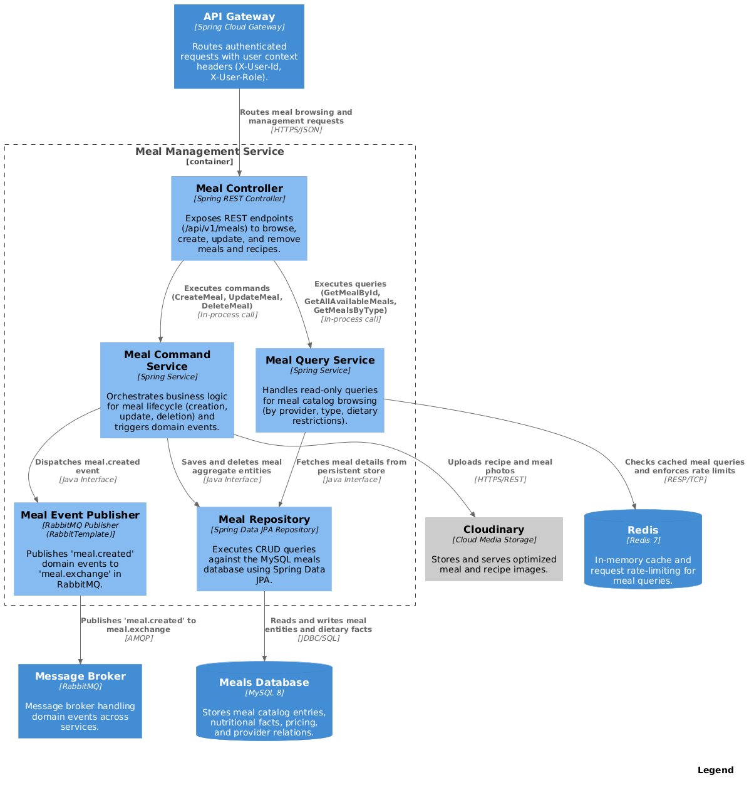

# Mealflow Management Microservice

MealFlow is a state-of-the-art web platform that connects health-conscious consumers with local providers of ready-to-eat and ready-to-heat healthy
meals. As a core component of the MealFlow microservices ecosystem, the **Meal Management Service** is a robust RESTful API built on the foundations of
Domain-Driven Design (DDD) and Command Query Responsibility Segregation (CQRS).

Developed with Java 21, Spring Boot 3, and MySQL, this microservice handles the complete lifecycle of meal catalog management, nutritional breakdowns
(calories, macronutrients), media asset uploads via Cloudinary, and event-driven notifications through RabbitMQ. Its modular architecture strictly
separates bounded contexts and segregates data mutation (Commands) from data retrieval (Queries), ensuring high performance, auditability, and scalability.

## Tech Stack

* **Language:** Java 21 (LTS)
* **Framework:** Spring Boot 3.5.4 / Spring Cloud 2025.0.0
*  * **Architecture:** Domain-Driven Design (DDD), CQRS (Command Query Responsibility Segregation), Microservices Architecture
*  * **Database:** MySQL 8+
*  * **Persistence & ORM:** Spring Data JPA / Hibernate
* **External Services:** Cloudinary API (image storage, optimization, and CDN delivery)    * **Message Broker:** RabbitMQ (AMQP Event-Driven integration)
* **Service Discovery:** Netflix Eureka Client
* **Security:** Spring Security with JWT (JSON Web Tokens) validation
* **API Documentation:** SpringDoc OpenAPI 3 / Swagger UI
* **Build Tool:** Maven 3.9+
* **Containerization:** Docker & Docker Compose
      
## Prerequisites

* Java 21 (LTS)
* Maven 3.9+
* MySQL 8.0+
* RabbitMQ 3.12+
* Netflix Eureka Server
* Redis 7+ (optional)
* Docker & Docker Compose (optional)
* Cloudinary account and API credentials

## Project Structure

The project is architected following Domain-Driven Design (DDD) and Command Query Responsibility Segregation (CQRS) principles. It is structured into bounded contexts and separated into distinct architectural layers:

```text
src/main/java/com/gabrielmamani/mealmanagement/
├── meals/                                # Meals Bounded Context
│   ├── domain/                           # Core Domain Layer (Enterprise Business Logic)
│   │   ├── model/
│   │   │   ├── aggregates/               # Aggregate Roots (Meal entity)
│   │   │   ├── commands/                 # CQRS Mutation Commands
│   │   │   ├── queries/                  # CQRS Retrieval Queries
│   │   │   ├── events/                   # Domain Events (MealCreatedEvent)
│   │   │   └── valueobjects/             # Value Objects
│   │   └── repositories/                 # Domain Repository Interfaces
│   │
│   ├── application/                      # Application Layer
│   │   ├── internal/
│   │   │   ├── commandservices/          # Command Handlers
│   │   │   └── queryservices/            # Query Handlers
│   │   └── events/                       # Event Publishers & RabbitMQ Handlers
│   │
│   ├── infrastructure/                   # Infrastructure Layer
│   │   ├── persistence/jpa/              # JPA Repositories & Database Adapters
│   │   └── external/cloudinary/           # Cloudinary Media Storage Adapter
│   │
│   └── interfaces/                       # Presentation Layer
│       └── rest/
│           ├── resources/                # Request & Response DTOs
│           ├── transform/                # Assemblers & Mappers
│           └── MealsController.java      # REST API Endpoints
│
└── shared/                               # Shared Kernel
    ├── domain/model/aggregates/          # Auditable Model Base Classes
    ├── infrastructure/
    │   ├── cache/                        # Redis Cache Configuration
    │   ├── documentation/                # OpenAPI / Swagger UI
    │   ├── persistence/jpa/              # Global JPA & Naming Strategies
    │   └── security/                     # Spring Security, JWT & CORS
    └── interfaces/rest/                  # Shared Response Wrappers & Exception Handlers
```

 ### Layer Responsibilities

  • Domain Layer: Encapsulates the core business rules, domain entities, value objects, domain events, and repository contracts. It remains completely
  independent of frameworks, databases, and UI concerns.
  • Application Layer: Orchestrates business use cases by coordinating domain aggregates and external services. Adheres strictly to CQRS by separating
  command handlers (mutations) from query handlers (read operations).
  • Infrastructure Layer: Implements technical concerns such as database persistence via Spring Data JPA/Hibernate, message broker integration (RabbitMQ),
  and third-party cloud services (Cloudinary image storage).
  • Interfaces Layer: Exposes the RESTful API endpoints, handles HTTP requests/responses, validates payloads, and transforms incoming DTOs into domain
  commands and outgoing entities into resource representations.
  • Shared Kernel: Provides cross-cutting concerns used across the service, including security filters (JWT), global exception handling, auditing, Redis
  caching, and OpenAPI documentation.

### Environment Variables

| Variable | Description | Default (Dev) |
    | :--- | :--- | :--- |
| `PORT` | Application HTTP server port | `8085` |
| `DB_URL` | JDBC connection URL for MySQL database | `jdbc:mysql://localhost:3306/mealfd` |
| `DB_USER` | MySQL database username | `root` |
| `DB_PASSWORD` | MySQL database password | `password` |
| `EUREKA_ENABLED` | Enables or disables Eureka service registration | `true` |
| `EUREKA_URL` | Netflix Eureka Service Registry URL | `http://localhost:8761/eureka` |
| `CLOUDINARY_CLOUD_NAME` | Cloudinary account cloud name for meal images | `your-cloud-name` |
| `CLOUDINARY_API_KEY` | Cloudinary API Key for authentication | `your-api-key` |
| `CLOUDINARY_API_SECRET` | Cloudinary API Secret for image upload requests | `your-api-secret` |
| `JWT_SECRET` | Secret key used to sign and validate JWT tokens | `replace-with-a-strong-random-secret` |
| `JWT_EXPIRATION_DAYS` | Expiration window for JWT authorization tokens in days | `7` |
| `RABBITMQ_HOST` | Host address of RabbitMQ message broker | `localhost` |
| `RABBITMQ_PORT` | Port of RabbitMQ AMQP protocol | `5672` |
| `RABBITMQ_USER` | RabbitMQ broker username | `guest` |
| `RABBITMQ_PASSWORD` | RabbitMQ broker password | `guest` |
| `REDIS_HOST` | Redis host address for caching | `localhost` |
| `REDIS_PORT` | Redis server port | `6379` |

## Getting Started
### 1) Database & Message Broker Setup

    Ensure MySQL and RabbitMQ are running. Create the target schema in MySQL:
    
    ```sql
    CREATE DATABASE IF NOT EXISTS mealfd;
│ Note: If running within the complete MealFlow ecosystem, make sure the Netflix Eureka Server is already running at http://localhost:8761/eureka.
──────
### 2) Run the Application
#### Using Maven Wrapper (Local)
Run with default local configuration:
./mvnw clean spring-boot:run
(On Windows PowerShell, use .\mvnw.cmd clean spring-boot:run)

Or override environment variables inline:

    PORT=8085 \
    DB_URL=jdbc:mysql://localhost:3306/mealfd \
    DB_USER=root \
    DB_PASSWORD=password \
    CLOUDINARY_CLOUD_NAME=your-cloud-name \
    CLOUDINARY_API_KEY=your-api-key \
    CLOUDINARY_API_SECRET=your-api-secret \
    RABBITMQ_HOST=localhost \
    RABBITMQ_PORT=5672 \
    JWT_SECRET=replace-with-a-strong-random-secret \
    ./mvnw clean spring-boot:run
#### Using Docker
Build the container image:
docker build -t mealflow-meal-management-service .
Run the container:

    docker run -d -p 8085:8085 \
      --name mealflow-meal-management \
      -e DB_URL=jdbc:mysql://host.docker.internal:3306/mealfd \
      -e DB_USER=root \
      -e DB_PASSWORD=password \
      -e RABBITMQ_HOST=host.docker.internal \
      -e RABBITMQ_PORT=5672 \
      -e EUREKA_URL=http://host.docker.internal:8761/eureka \
      -e CLOUDINARY_CLOUD_NAME=your-cloud-name \
      -e CLOUDINARY_API_KEY=your-api-key \
      -e CLOUDINARY_API_SECRET=your-api-secret \
      -e JWT_SECRET=replace-with-a-strong-random-secret \
      mealflow-meal-management-service
──────
### 3) API Documentation

Once the service is started, access the interactive OpenAPI documentation and Swagger UI at:

• Swagger UI: http://localhost:8085/swagger-ui/index.html
• OpenAPI Specification (JSON): http://localhost:8085/v3/api-docs


## API Surface
### Meal Catalog & Provider Management (`/api/v1/meals`)

    * **`POST /api/v1/meals`**: Creates a new meal associated with the authenticated provider. *(Requires `ROLE_PROVIDER`)*
    * **`PUT /api/v1/meals/{mealId}`**: Updates meal details, pricing, and nutritional information. *(Requires `ROLE_PROVIDER` - Owner only)*
    * **`DELETE /api/v1/meals/{mealId}`**: Removes an existing meal from the catalog. *(Requires `ROLE_PROVIDER` or `ROLE_ADMIN`)*
    * **`GET /api/v1/meals`**: Lists all currently available healthy meals across all providers. *(Open to consumers)*
    * **`GET /api/v1/meals/{mealId}`**: Retrieves full meal details, including comprehensive nutritional breakdown (calories, proteins, carbs, fats).
    * **`GET /api/v1/meals/provider`**: Lists all meals (active and inactive) owned by the requesting provider. *(Requires `ROLE_PROVIDER`)*
    * **`GET /api/v1/meals/provider/{providerId}`**: Lists all public meals published by a specific provider.
    * **`GET /api/v1/meals/type/{mealType}`**: Filters available meals by type (`BREAKFAST`, `LUNCH`, `DINNER`, `SNACK`).
    * **`POST /api/v1/meals/upload-image`**: Uploads meal photograph files to Cloudinary and returns secure CDN URLs (`multipart/form-data`). *(Requires
`ROLE_PROVIDER`)*

    ---
## Security Model
* **JWT Validation via API Gateway:** The API Gateway acts as the single entry point. It receives the `Authorization: Bearer <token>` header from the
  frontend, verifies the JWT signature, and forwards the request downstream.
    * **Identity Propagation (`X-User-Id`):** Once authenticated, the Gateway extracts the user ID from the token and injects it into the request header
      (`X-User-Id`). The Meal service reads this header to link meals to providers.
    * **Role-Based Access Control:**
        * `ROLE_CONSUMER`: Can view available meals and nutritional details.
        * `ROLE_PROVIDER`: Can create, edit, delete, and upload images for their meals.
        * `ROLE_ADMIN`: Can manage and moderate any meal on the platform.
    * **Meal Ownership Check:** On update and delete requests, the service checks that the `X-User-Id` in the header matches the `providerId` stored in the
      meal record, preventing providers from modifying each other's menus.
## Development Conventions

* **DDD + CQRS:** Strict separation of concerns. All state mutations are handled by `MealCommandService` (via command records), while data queries are
  handled independently by `MealQueryService`.
* **Persistence Agnostic Domain:** The core domain model (`Meal` aggregate, `Price`, `NutritionalInformation`, `MealCategory`) remains decoupled from
  database frameworks, protecting business rules from external technology changes.
* **Event-Driven Messaging:** Domain events (e.g., `MealCreatedEvent`) are published asynchronously to RabbitMQ to notify downstream services (such as
  notification-service and search indexing).
* **Cloud Storage Abstraction:** File uploads are abstracted through `CloudinaryImageService` inside the infrastructure layer, keeping presentation
  controllers decoupled from cloud SDK specifics.
* **Assembler Pattern:** Separation between incoming request resources, domain commands/queries, and outgoing response DTOs using dedicated assemblers
  (`CreateMealCommandFromResourceAssembler`, `MealResourceFromEntityAssembler`).
* **Error Handling:** Standardized response generation and unified error formatting through `ResponseEntityAssembler` and global exception handling.

## Additional Documentation

### Component Diagram


